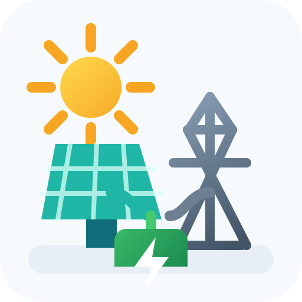
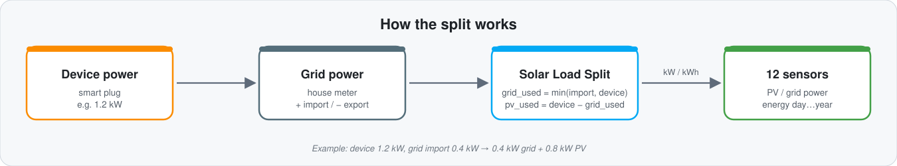
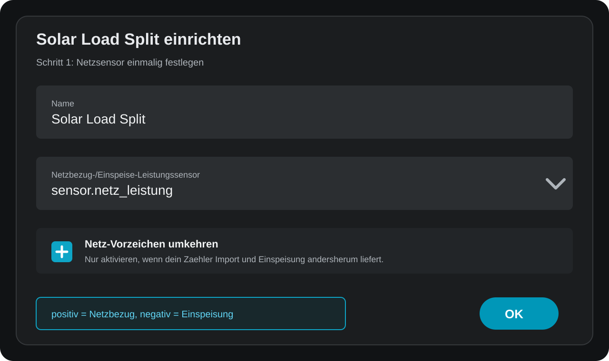
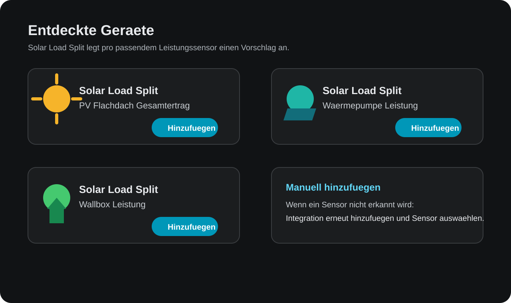
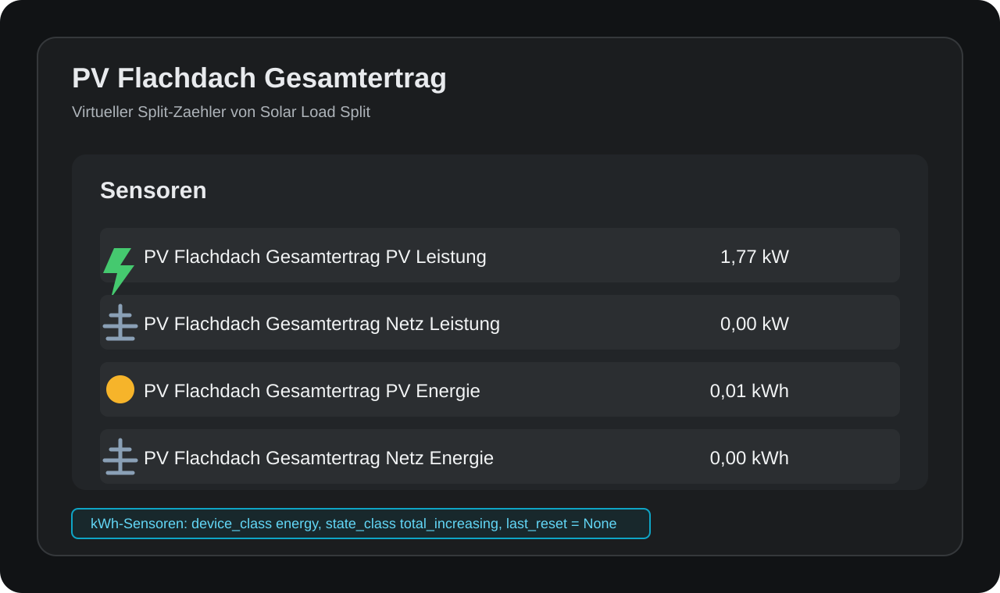

# Solar Load Split

[English](README.md) · **Deutsch**

[](https://hacs.xyz)



**Solar Load Split** ist eine Home-Assistant Custom Integration für HACS. Sie teilt den Verbrauch eines Geräts in zwei Anteile auf:

- Solar/PV-Leistung und Solar/PV-Energie
- Netz-Leistung und Netz-Energie

Die Einrichtung läuft komplett über die Home-Assistant-Oberfläche. YAML ist nicht nötig.

Version `1.0.2` ist mit Home Assistant `2026.8` kompatibel und gegen `2026.8.1`
getestet.

## Was macht die Integration?

Du richtest einmal deinen Netzbezug-/Einspeise-Leistungssensor ein. Danach kann Solar Load Split passende Geräte-Leistungssensoren erkennen oder manuell hinzufügen. Optional kannst du pro Gerät auch einen Energiezähler des gleichen Zwischensteckers oder Shelly auswählen.

Aus jedem Gerät entstehen zwölf Sensoren:

| Sensor | Einheit | Device class | State class |
| --- | --- | --- | --- |
| `<Gerätename> PV Leistung` | kW | power | measurement |
| `<Gerätename> Netz Leistung` | kW | power | measurement |
| `<Gerätename> PV Energie` | kWh | energy | total_increasing |
| `<Gerätename> Netz Energie` | kWh | energy | total_increasing |
| `<Gerätename> PV Tagesenergie` | kWh | energy | total |
| `<Gerätename> Netz Tagesenergie` | kWh | energy | total |
| `<Gerätename> PV Wochenenergie` | kWh | energy | total |
| `<Gerätename> Netz Wochenenergie` | kWh | energy | total |
| `<Gerätename> PV Monatsenergie` | kWh | energy | total |
| `<Gerätename> Netz Monatsenergie` | kWh | energy | total |
| `<Gerätename> PV Jahresenergie` | kWh | energy | total |
| `<Gerätename> Netz Jahresenergie` | kWh | energy | total |

Die kWh-Sensoren sind für das Home-Assistant Energy Dashboard vorbereitet:

- `device_class: energy`
- `native_unit_of_measurement: kWh`
- Gesamtzähler: `state_class: total_increasing`
- Tages-/Wochen-/Monats-/Jahreszähler: `state_class: total`
- `last_reset = None`

## So funktioniert die Aufteilung



## Bilder zur Einrichtung

### 1. Netzsensor einmalig einrichten



Der Netzsensor muss Leistung in `W` oder `kW` liefern.

Nach optionaler Umkehrung gilt:

- **positiv** = Netzbezug
- **negativ** = Einspeisung
- **innerhalb der Netz-Totzone** = PV/Akku, wird als PV gezählt
- **PV/Akku-Anteil** = Geräte-Leistung minus echter Netzbezug

Wenn dein Zähler die Vorzeichen andersherum liefert, aktiviere **Netz-Vorzeichen umkehren**.

### 2. Entdeckte Geräte bestätigen



Solar Load Split durchsucht vorhandene `sensor`-Entitäten nach Leistungssensoren:

- `device_class: power`
- oder Einheit `W` / `kW`

Offensichtliche Netzsensoren werden als Gerätesensor übersprungen, wenn Name oder Entity-ID typische Begriffe enthalten, zum Beispiel:

- `grid`
- `netz`
- `meter`
- `utility`
- `einspeis`
- `bezug`

Für jedes passende, noch nicht konfigurierte Gerät wird ein eigener **Entdeckt**-Eintrag angelegt.

### 3. Erzeugte Sensoren



Alle Sensoren werden unter einem virtuellen Gerät gruppiert. Der Name, den du beim Hinzufügen vergibst, wird direkt in die Entitätsnamen übernommen.

## Installation

### HACS Custom Repository

1. In HACS ein neues benutzerdefiniertes Repository hinzufügen.
2. Kategorie **Integration** auswählen.
3. Repository installieren.
4. Home Assistant neu starten.
5. **Einstellungen > Geräte & Dienste > Integration hinzufügen** öffnen.
6. **Solar Load Split** suchen und hinzufügen.

### Manuelle Installation

1. Den Ordner `custom_components/pv_device_split` nach `config/custom_components/pv_device_split` kopieren.
2. Home Assistant neu starten.
3. **Einstellungen > Geräte & Dienste > Integration hinzufügen** öffnen.
4. **Solar Load Split** suchen und hinzufügen.

## Einrichtung

### Basis-Eintrag

Beim ersten Einrichten fragt Solar Load Split nach:

- `name`: Anzeigename des Basis-Eintrags
- `grid_power`: Netzbezug-/Einspeise-Leistungssensor
- `invert_grid`: optional, wenn dein Netzsensor die Vorzeichen andersherum liefert
- `enable_discovery`: automatische Erkennung aktivieren oder deaktivieren, Standard ist aus
- `grid_buffer_seconds`: zeitlicher Netzpuffer in Sekunden
- `grid_deadband_watts`: Netz-Totzone in Watt, Standard ist `100 W`

Dieser Basis-Eintrag erzeugt noch keine Split-Sensoren. Er speichert nur den Netzsensor, der für alle Geräte verwendet wird.

Der zeitliche Netzpuffer entprellt nur den Wechsel zwischen Netzbezug und
Einspeisung. Die aktuelle Leistungshöhe wird nicht gemittelt. Das verhindert,
dass Solar Load Split bei kurzen Akku-/Wechselrichter-Schwankungen sofort
zwischen Netzbezug und Einspeisung springt. `0` deaktiviert den Puffer. Standard
ist `0` Sekunden.

Die Netz-Totzone behandelt kleine Werte rund um `0 W` als PV-/Akku-Versorgung.
Beispiel: Bei `100 W` Totzone werden `+80 W` Netzbezug oder `-50 W` Einspeisung
nicht als echter Netzbezug gezählt. Das ist hilfreich, wenn ein Akku oder
Wechselrichter den Netzanschlusspunkt regelt und der Zähler ständig kleine
Werte wie `9-80 W` meldet. Innerhalb der Totzone zählt Solar Load Split die
aktuelle Geräte-Leistung als PV-Energie und die Netz-Energie bleibt bei `0`.

Wichtig: Der Netzsensor zeigt den Wert am Hausanschluss **nach** dem Gerät.
Darum wird der echte Netzanteil des Geräts aus dem positiven Netzbezug
abgeleitet und auf die Geräte-Leistung begrenzt. Alles, was nicht durch echten
Netzbezug gedeckt ist, wird als PV-/Akku-Anteil gezählt.

### Automatische Erkennung

Nach dem Laden des Basis-Eintrags scannt Solar Load Split vorhandene Leistungssensoren und erstellt Vorschläge unter **Entdeckt**.

Wenn **Automatische Erkennung aktivieren** ausgeschaltet ist, werden keine Discovery-Vorschläge erzeugt. Manuelles Hinzufügen funktioniert weiterhin.
Der Schalter ist standardmäßig ausgeschaltet.

Der Scan läuft:

- beim Start von Home Assistant
- wenn der Basis-Eintrag geladen wird
- wenn ein Solar-Load-Split-Eintrag geladen wird
- zusätzlich verzögert nach dem Start, damit spät geladene Sensoren erkannt werden

Wenn später neue Leistungssensoren hinzukommen, lade die Integration neu oder starte Home Assistant neu.

### Gerät manuell hinzufügen

Wenn ein Sensor nicht automatisch erkannt wird:

1. **Integration hinzufügen** öffnen.
2. **Solar Load Split** erneut auswählen.
3. Falls Home Assistant erst eine Auswahlseite zeigt, **Eine weitere Instanz von Solar Load Split einrichten** auswählen.
4. Der Dialog **Gerät manuell hinzufügen** öffnet sich direkt.
5. Geräte-Leistungssensor auswählen.
6. Optional den Geräte-Energiesensor des gleichen Messgeräts auswählen.
7. Falls nötig Netzsensor kontrollieren oder auswählen.
8. Bestätigen.

Der Netzsensor und `invert_grid` werden aus dem Basis-Eintrag übernommen, wenn ein passender Eintrag erkannt wurde. Andernfalls kannst du sie im manuellen Dialog auswählen.

### Bestehende Einträge ändern

Bereits eingerichtete Einträge kannst du über **Konfigurieren** bearbeiten.

Je nach Eintrag kannst du anpassen:

- Name
- Geräte-Leistungssensor
- Geräte-Energiesensor
- Netzbezug-/Einspeise-Leistungssensor
- Netz-Vorzeichen umkehren
- Automatische Erkennung aktivieren
- Zeitlicher Netzpuffer
- Netz-Totzone

Nach dem Speichern wird der Eintrag automatisch neu geladen.

## Berechnungslogik

Die Aufteilung nutzt immer den Geräte-Leistungssensor und den Netzsensor.
Wenn ein optionaler Geräte-Energiesensor vorhanden ist, werden die echten
kWh-Deltas dieses Sensors auf PV und Netz verteilt. Das liefert die genaueste
Summe, weil `PV + Netz` dann direkt an den echten Energiezähler des
Zwischensteckers oder Shelly gekoppelt ist.

```text
if invert_grid:
    grid_power = grid_power * -1

grid_power sign changes are delayed by grid_buffer_seconds

if abs(grid_power) <= grid_deadband_watts:
    grid_power = 0

grid_used = min(max(grid_power, 0), device_power)
pv_used = max(device_power - grid_used, 0)

if device_energy is available:
    device_energy_delta = current_device_energy - last_device_energy
    grid_energy_delta = device_energy_delta * grid_used / (pv_used + grid_used)
    pv_energy_delta = device_energy_delta - grid_energy_delta
else:
    grid_energy_delta = grid_used * elapsed_time
    pv_energy_delta = pv_used * elapsed_time
```

Ausgabe:

- Leistungssensoren in `kW`
- Energiesensoren in `kWh`
- Rundung auf 2 Nachkommastellen

Intern rechnet Solar Load Split mit voller Präzision und rundet erst für die
Anzeige der Sensorwerte.

## Beispiele

**Energie-Dashboard:** Unter *Einstellungen → Dashboards → Energie → Einzelne Geräte* die Sensoren `<Gerät> PV Energie` und `<Gerät> Netz Energie` hinzufügen – so siehst du, wie viel deines Verbrauchs vom Dach kam.

**Solaranteil in Prozent** (Template-Sensor):

```yaml
template:
  - sensor:
      - name: Wärmepumpe Solaranteil heute
        unit_of_measurement: "%"
        state: >
          
          
          {{ (100 * pv / (pv + netz)) | round(0) if (pv + netz) > 0 else 0 }}
```

**Ersparnis heute** (Strompreis 0,32 €/kWh minus Einspeisevergütung 0,08 €/kWh):

```yaml
template:
  - sensor:
      - name: Wärmepumpe PV-Ersparnis heute
        unit_of_measurement: "€"
        state: >
          {{ (states('sensor.warmepumpe_pv_tagesenergie') | float(0) * (0.32 - 0.08)) | round(2) }}
```

Die Entity-IDs ergeben sich aus dem Namen, den du beim Hinzufügen vergibst.

## Ordnerstruktur

```text
.
├── docs/
│   └── images/
│       ├── setup-01-grid.svg
│       ├── setup-02-discovery.svg
│       └── setup-03-entities.svg
├── hacs.json
├── logo.svg
├── README.md
└── custom_components/
    └── pv_device_split/
        ├── __init__.py
        ├── config_flow.py
        ├── const.py
        ├── discovery.py
        ├── icon.svg
        ├── manifest.json
        ├── sensor.py
        ├── strings.json
        └── translations/
            ├── de.json
            └── en.json
```

## Hinweise

- Die Integration ist UI-only.
- Die Integration ist HACS-kompatibel.
- Deutsch und Englisch werden über Home-Assistant-Translations unterstützt.
- Jeder Split-Eintrag hat stabile Unique IDs.
- Eigene Entitätsnamen bleiben bei Updates erhalten. Alte automatisch erzeugte Namen
  werden einmalig auf das aktuelle Home-Assistant-Übersetzungssystem migriert; Entity-IDs
  und Automationen bleiben dabei unverändert.

## Lizenz

MIT – siehe [LICENSE](LICENSE).
