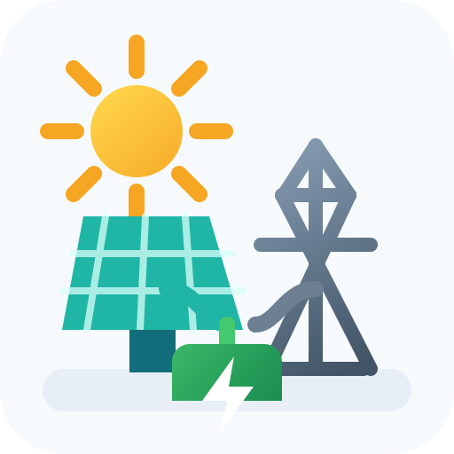
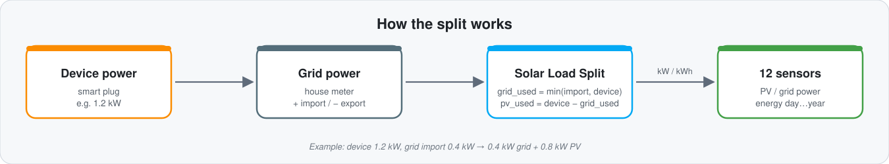
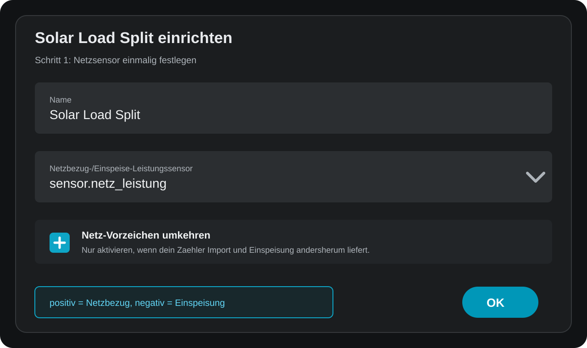
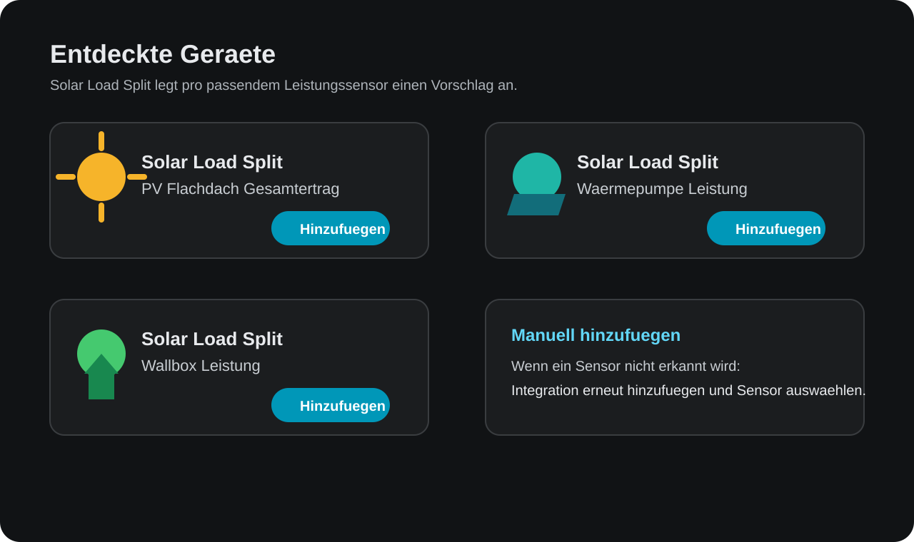
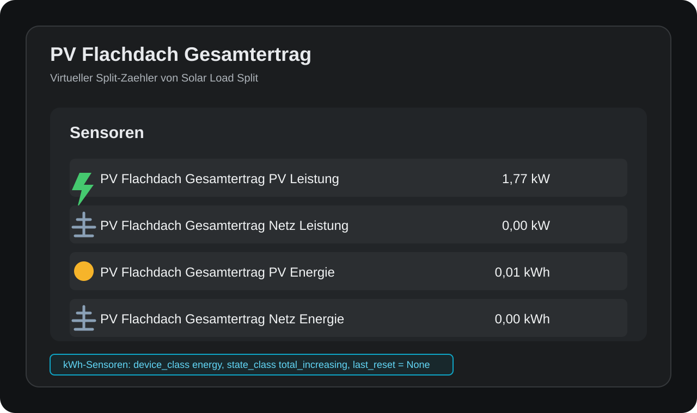

# Solar Load Split

**English** · [Deutsch](README.de.md)

[](https://hacs.xyz)



**Solar Load Split** is a Home Assistant custom integration for HACS. It splits the consumption of a device into two shares:

- solar/PV power and solar/PV energy
- grid power and grid energy

Setup runs entirely in the Home Assistant UI. No YAML needed.

Version `1.0.2` is compatible with Home Assistant `2026.8` and tested against `2026.8.1`.

## What does it do?

You set up your grid import/export power sensor once. Solar Load Split then discovers matching device power sensors, or you add them manually. Optionally you can pick an energy meter of the same smart plug or Shelly per device.

Every device gets twelve sensors (names are created in your HA language; German shown):

| Sensor | Unit | Device class | State class |
| --- | --- | --- | --- |
| `<device name> PV Leistung` (PV power) | kW | power | measurement |
| `<device name> Netz Leistung` (grid power) | kW | power | measurement |
| `<device name> PV Energie` (PV energy) | kWh | energy | total_increasing |
| `<device name> Netz Energie` (grid energy) | kWh | energy | total_increasing |
| `<device name> PV Tagesenergie` / `Netz Tagesenergie` (daily) | kWh | energy | total |
| `<device name> PV Wochenenergie` / `Netz Wochenenergie` (weekly) | kWh | energy | total |
| `<device name> PV Monatsenergie` / `Netz Monatsenergie` (monthly) | kWh | energy | total |
| `<device name> PV Jahresenergie` / `Netz Jahresenergie` (yearly) | kWh | energy | total |

The kWh sensors are ready for the Home Assistant Energy dashboard:

- `device_class: energy`
- `native_unit_of_measurement: kWh`
- Total counters: `state_class: total_increasing`
- Day/week/month/year counters: `state_class: total`
- `last_reset = None`

## How the split works



## Setup in pictures

*(The setup mock-ups show the German UI.)*

### 1. Set up the grid sensor once



The grid sensor must report power in `W` or `kW`.

After optional inversion:

- **positive** = grid import
- **negative** = export / feed-in
- **within the grid deadband** = PV/battery, counted as PV
- **PV/battery share** = device power minus real grid import

If your meter reports the signs the other way round, enable **Invert grid sign**.

### 2. Confirm discovered devices



Solar Load Split scans existing `sensor` entities for power sensors:

- `device_class: power`
- or unit `W` / `kW`

Obvious grid sensors are skipped as device sensors when the name or entity ID contains typical terms, for example `grid`, `netz`, `meter`, `utility`, `einspeis`, `bezug`.

For each matching, not yet configured device a separate **Discovered** entry is created.

### 3. Created sensors



All sensors are grouped under one virtual device. The name you give when adding is used directly in the entity names.

## Installation

### HACS custom repository

1. Add `https://github.com/dr-apple/Solar-Load-Split` as a custom repository in HACS.
2. Choose category **Integration**.
3. Install the repository.
4. Restart Home Assistant.
5. Open **Settings > Devices & services > Add integration**.
6. Search for **Solar Load Split** and add it.

### Manual installation

1. Copy `custom_components/pv_device_split` to `config/custom_components/pv_device_split`.
2. Restart Home Assistant.
3. Open **Settings > Devices & services > Add integration**.
4. Search for **Solar Load Split** and add it.

## Configuration

### Base entry

On first setup Solar Load Split asks for:

- `name`: display name of the base entry
- `grid_power`: grid import/export power sensor
- `invert_grid`: optional, if your grid sensor reports the signs the other way round
- `enable_discovery`: enable or disable automatic discovery, default is off
- `grid_buffer_seconds`: time buffer for the grid sign in seconds
- `grid_deadband_watts`: grid deadband in watts, default `100 W`

This base entry doesn't create split sensors yet. It only stores the grid sensor used for all devices.

The time buffer only debounces the switch between grid import and export. The current power level is not averaged. This prevents Solar Load Split from jumping between import and export on short battery/inverter fluctuations. `0` disables the buffer (default).

The grid deadband treats small values around `0 W` as PV/battery supply. Example: with a `100 W` deadband, `+80 W` import or `-50 W` export are not counted as real grid import. This helps when a battery or inverter regulates the grid connection point and the meter constantly reports small values like `9-80 W`. Within the deadband the current device power counts as PV energy and grid energy stays `0`.

Important: the grid sensor shows the value at the house connection **after** the device. The device's real grid share is therefore derived from the positive grid import and limited to the device power. Everything not covered by real grid import counts as PV/battery share.

### Automatic discovery

After the base entry is loaded, Solar Load Split scans existing power sensors and creates suggestions under **Discovered**. If **Enable automatic discovery** is off (default), no suggestions are created; manual adding still works.

The scan runs at Home Assistant start, when the base entry or any Solar Load Split entry is loaded, and once more delayed after start so late sensors are found. If new power sensors appear later, reload the integration or restart Home Assistant.

### Add a device manually

If a sensor isn't discovered automatically:

1. Open **Add integration**.
2. Select **Solar Load Split** again.
3. If Home Assistant shows a selection page first, choose **Set up another instance of Solar Load Split**.
4. The **Add device manually** dialog opens directly.
5. Select the device power sensor.
6. Optionally select the device energy sensor of the same meter.
7. Check or select the grid sensor if needed.
8. Confirm.

The grid sensor and `invert_grid` are taken from the base entry if one is found; otherwise you can choose them in the manual dialog.

### Change existing entries

Use **Configure** on an entry to change: name, device power sensor, device energy sensor, grid power sensor, invert grid sign, automatic discovery, time buffer, deadband. The entry reloads after saving.

## Calculation

The split always uses the device power sensor and the grid sensor. If an optional device energy sensor is present, its real kWh deltas are distributed to PV and grid – this gives the most accurate total, because `PV + grid` is then tied directly to the plug's/Shelly's real energy counter.

```text
if invert_grid:
    grid_power = grid_power * -1

grid_power sign changes are delayed by grid_buffer_seconds

if abs(grid_power) <= grid_deadband_watts:
    grid_power = 0

grid_used = min(max(grid_power, 0), device_power)
pv_used = max(device_power - grid_used, 0)

if device_energy is available:
    device_energy_delta = current_device_energy - last_device_energy
    grid_energy_delta = device_energy_delta * grid_used / (pv_used + grid_used)
    pv_energy_delta = device_energy_delta - grid_energy_delta
else:
    grid_energy_delta = grid_used * elapsed_time
    pv_energy_delta = pv_used * elapsed_time
```

Output: power sensors in `kW`, energy sensors in `kWh`, rounded to 2 decimals for display (calculation runs at full precision).

## Examples

**Energy dashboard:** under *Settings → Dashboards → Energy → Individual devices* add `<device> PV Energie` and `<device> Netz Energie` – you see how much of the consumption came from the roof.

**Solar share in percent** (template sensor):

```yaml
template:
  - sensor:
      - name: Heat pump solar share today
        unit_of_measurement: "%"
        state: >
          
          
          {{ (100 * pv / (pv + grid)) | round(0) if (pv + grid) > 0 else 0 }}
```

**Savings today** (electricity price 0.32 €/kWh minus feed-in tariff 0.08 €/kWh):

```yaml
template:
  - sensor:
      - name: Heat pump PV savings today
        unit_of_measurement: "€"
        state: >
          {{ (states('sensor.heat_pump_pv_tagesenergie') | float(0) * (0.32 - 0.08)) | round(2) }}
```

Entity IDs follow the name you give when adding the device.

## Folder structure

```text
.
├── docs/
│   └── images/
│       ├── setup-01-grid.svg
│       ├── setup-02-discovery.svg
│       └── setup-03-entities.svg
├── hacs.json
├── logo.svg
├── README.md
└── custom_components/
    └── pv_device_split/
        ├── __init__.py
        ├── config_flow.py
        ├── const.py
        ├── discovery.py
        ├── icon.svg
        ├── manifest.json
        ├── sensor.py
        ├── strings.json
        └── translations/
            ├── de.json
            └── en.json
```

## Notes

- UI-only integration, HACS-compatible.
- German and English via Home Assistant translations.
- Every split entry has stable unique IDs.
- Custom entity names are kept on updates. Old auto-generated names are migrated once to the current translation system; entity IDs and automations stay unchanged.

## License

MIT – see [LICENSE](LICENSE).
